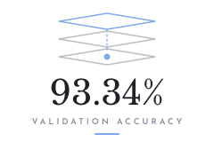
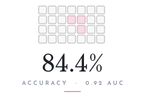
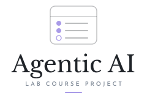
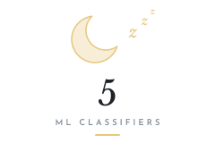
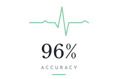
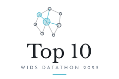
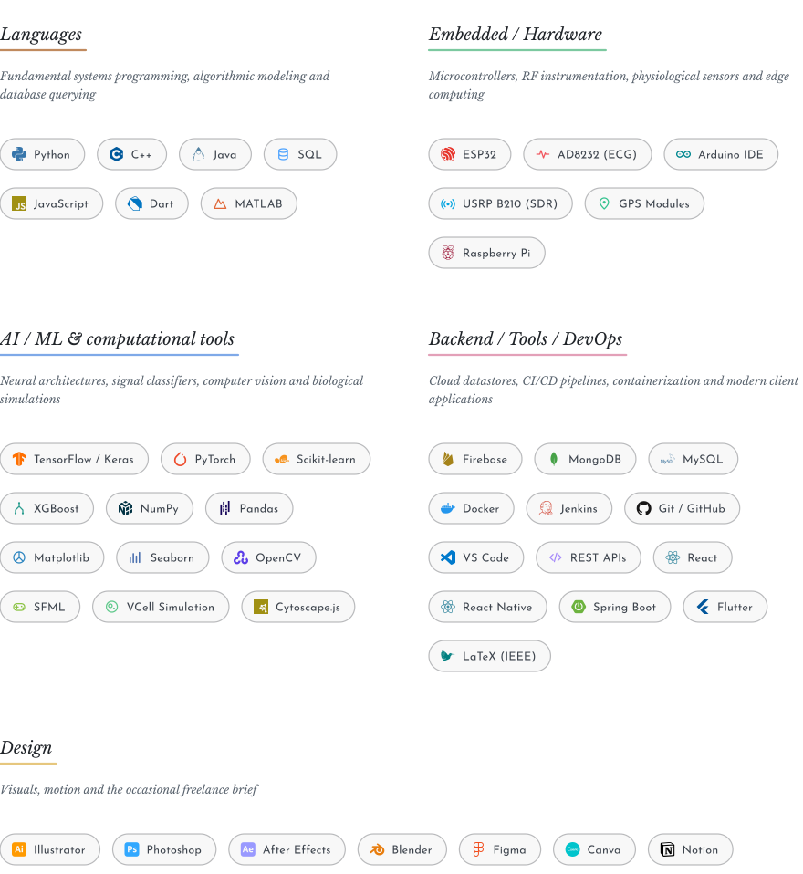

<picture><source media="(prefers-color-scheme: dark)" srcset="assets/dark/header.svg"></picture>

    

## About me

I'm a final-year Computer Science student at KLE Technological University, Belagavi.

Most of what I build sits at the intersection of software, embedded systems and AI — turning ideas into practical systems through code, hardware and intelligent models.

I enjoy building things from experiments and research to products, visuals and interactive experiences.

When the code gets quiet, I design — Illustrator, motion and the occasional freelance brief.

- KLE Tech, Belagavi · Class of 2027
- Open to opportunities

## Stuff I've built

<a href="https://github.com/aniiiket08/indoor-floor-prediction-wifi-sdr"><picture><source media="(prefers-color-scheme: dark)" srcset="assets/dark/fig-01.svg"></picture></a>

### [Indoor Floor Prediction](https://github.com/aniiiket08/indoor-floor-prediction-wifi-sdr) &nbsp;

Floor prediction from Wi-Fi RSSI fingerprints with a 1D CNN on UJIIndoorLoc. A USRP B210 SDR captures real 2.4 GHz signals and decodes beacons through gr-ieee802-11.

`Python` `1D CNN` `USRP B210` `gr-ieee802-11`

 

---

<a href="https://github.com/aniiiket08/automated-prostate-cancer-detection"><picture><source media="(prefers-color-scheme: dark)" srcset="assets/dark/fig-02.svg"></picture></a>

### [Prostate Cancer Detection](https://github.com/aniiiket08/automated-prostate-cancer-detection) &nbsp;

Prostate cancer detection from histopathology images. GLCM + LBP texture features with XGBoost beat deep CNNs before pruning and quantization for on-device inference.

`XGBoost` `GLCM + LBP` `SICAPv2` `Edge inference`

 

---

<a href="https://github.com/aniiiket08?tab=repositories"><picture><source media="(prefers-color-scheme: dark)" srcset="assets/dark/fig-03.svg"></picture></a>

### [Meeting Organizer Agent](https://github.com/aniiiket08?tab=repositories) &nbsp;

An agent that takes a meeting from scheduling to signed-off minutes and tracked action items. Worklet 4 of the Agentic AI lab course.

`Agentic AI` `Scheduling` `Minutes` `Action items`

 

---

<a href="https://github.com/aniiiket08/neurosleep-digital-twin"><picture><source media="(prefers-color-scheme: dark)" srcset="assets/dark/fig-04.svg"></picture></a>

### [NeuroSleep Digital Twin](https://github.com/aniiiket08/neurosleep-digital-twin) &nbsp;

A multi-scale digital twin of the sleep-deprived brain with VCell metabolic modeling and Hodgkin-Huxley-inspired spiking. Cytoscape connectivity and five classifiers feed an interactive React dashboard.

`VCell` `Cytoscape` `React` `ML classifiers`

 

---

<a href="https://github.com/aniiiket08/smart-wearable-attendance-esp32"><picture><source media="(prefers-color-scheme: dark)" srcset="assets/dark/fig-05.svg"></picture></a>

### [Smart Wearable Attendance](https://github.com/aniiiket08/smart-wearable-attendance-esp32) &nbsp;

Attendance that cannot be proxied: an ECG biometric identity check plus GPS geofencing on an ESP32 and synced to Firebase in real time.

`ESP32` `ECG` `GPS` `Firebase`

 

---

<a href="https://github.com/aniiiket08/adhd-diagnostic-modeling-fmri"><picture><source media="(prefers-color-scheme: dark)" srcset="assets/dark/fig-06.svg"></picture></a>

### [ADHD Diagnosis](https://github.com/aniiiket08/adhd-diagnostic-modeling-fmri) &nbsp;

ADHD classification from neuroimaging and behavioral data using PCA and SMOTE with a voting ensemble. A degree-centrality analysis looks at sex differences in resting-state fMRI.

`Python` `fMRI` `PCA` `SMOTE`

 

*Next one's loading…*

## What I work with

<picture><source media="(prefers-color-scheme: dark)" srcset="assets/dark/skills.svg"></picture>

## Wins & papers

- **2025** · Top 10 worldwide, WiDS Datathon 2025 (1000+ teams from 100+ countries)
- **2026** · Paper presented at IEEE ICONAT 2026
- **2025** · Paper presented at SGCNSP 2025, Singapore

## Say hi

Building something at the edge of ML and the physical world? Let's build something.

    

 

<picture><source media="(prefers-color-scheme: dark)" srcset="assets/dark/footer.svg"></picture>

